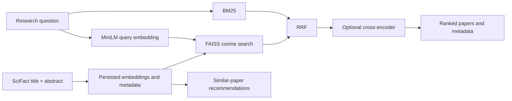

# ScholarMind AI

**Evaluating Hybrid Neural and Lexical Retrieval for Scientific Literature Discovery.**

A locally executed research-paper search platform: genuine BM25 and transformer retrieval,
FAISS indexing, reciprocal rank fusion, neural reranking, and content-based recommendations.
React/TypeScript connects to FastAPI over a real 5,183-document SciFact corpus. No external
LLM or paid service is required for search. This is a reproducible study of established
retrieval methods, not a claim of a novel architecture.


## Retrieval pipeline



Four selectable methods: Keyword, Semantic, Hybrid, and Hybrid + reranking. The UI includes
query examples, result pagination, paper details, related papers, explicit score types,
loading/error states, responsive layout and a saved-results evaluation dashboard.
Authors, years and source URLs appear only when available. SciFact metadata is not enriched
with unverified external identifiers. Similarity scores are not probabilities.

## Quick start — Windows PowerShell

Prerequisites: Python 3.12, Node.js 22+, internet for the first dataset/model downloads.
The local implementation was exercised on Windows, Python 3.12.15 and Node 25.3.0.
Use a virtual environment; allow a few minutes for CPU indexing and first model load.

```powershell
py -3.12 -m venv .venv
.venv\Scripts\python -m pip install -r requirements.lock.txt
Copy-Item .env.example .env
.venv\Scripts\python scripts/download_dataset.py --dataset scifact
.venv\Scripts\python scripts/build_indexes.py --dataset scifact
.venv\Scripts\python -m uvicorn backend.main:app --host 127.0.0.1 --port 8000
```

If Python 3.12 is not installed: `python -m pip install uv`, then
`python -m uv venv --python 3.12 .venv` installs a managed interpreter and creates the environment.
The equivalent Linux/macOS virtual-environment interpreter is `.venv/bin/python`.

In another terminal:

```powershell
cd frontend
npm ci
npm run dev
```

Open **http://127.0.0.1:5173**. API docs: **http://127.0.0.1:8000/docs**.
All commands run from the repository root except frontend npm commands.
After downloading weights, `HF_HUB_OFFLINE=1` and `TRANSFORMERS_OFFLINE=1` enforce offline use.
See [deployment and troubleshooting](docs/DEPLOYMENT.md) for details.

## Models and data

| Component | Implementation |
|---|---|
| Lexical | BM25Okapi, k1=1.5, b=0.75; casefolded Unicode word tokens |
| Dense | sentence-transformers/all-MiniLM-L6-v2, 384 dimensions, 256-token truncation |
| Vector index | Exact FAISS IndexFlatIP, L2-normalized embeddings |
| Fusion | RRF, one-based ranks, k=60, 100 candidates per retriever |
| Reranker | cross-encoder/ms-marco-MiniLM-L-6-v2; top 20 for benchmark; 512-token pairs |
| Recommendations | Stored paper vectors; cosine neighbors excluding the selected paper |

The index stores resolved model revisions, corpus hash, metadata checksums, stable IDs and
dimensions. To reproduce the recorded checkpoints exactly:

```powershell
.venv\Scripts\python scripts/build_indexes.py --dataset scifact --revision 1110a243fdf4706b3f48f1d95db1a4f5529b4d41 --reranker-revision 233902d25c440f23af6f7d6e94d2946bac0bee0a
```

[BEIR SciFact](https://github.com/beir-cellar/beir) is the initial benchmark: 5,183 documents,
809 train queries and 300 test queries with judgments. Train/test query IDs are disjoint.
Neither retrieval nor reranking sees judgments. See the [dataset card](docs/DATASET_CARD.md)
for snapshot, preprocessing, licensing notices and limitations, and the [model card](docs/MODEL_CARD.md).

## Benchmarks and research findings

[Measured result table and hypotheses](docs/BENCHMARK_RESULTS.md) ·
[Technical report](docs/TECHNICAL_REPORT.md) · [Protocol](docs/EXPERIMENTS.md)


| Method | nDCG@10 | Recall@100 | MAP@100 | P95 engine latency |
|---|---:|---:|---:|---:|
| BM25 | 0.6519 | 0.8731 | 0.6132 | 24.6 ms |
| MiniLM dense | 0.6451 | 0.9250 | 0.6031 | 12.4 ms |
| Hybrid | 0.6816 | 0.9577 | 0.6444 | 39.7 ms |
| Hybrid + reranking | 0.6871 | 0.9577 | 0.6485 | 1323.7 ms |

Hybrid improves nDCG@10 over BM25 by 0.0298 (paired 95% bootstrap interval
[0.0066, 0.0526]). Reranking's additional 0.0055 has an interval spanning zero;
its relevance benefit is inconclusive despite its higher point estimate. Dense retrieval
finds a relevant top-10 document missed by BM25 on 33 queries, while the reverse occurs
on 26. These findings are specific to the measured SciFact setup.

Raw evidence: `experiments/results/scifact-test/results.json`, `summary.csv`, `per_query.csv`.
Results report nDCG@10, Recall@10/100, MAP@100, MRR@100, Precision@10, mean and P50/P95 latency,
stage timings, and paired bootstrap intervals. MAP is explicitly truncated at retrieval depth
100. Do not substitute it for an untruncated corpus-wide MAP claim.

```powershell
.venv\Scripts\python scripts/benchmark_models.py --config experiments/configs/protocol.json
.venv\Scripts\python scripts/run_ablations.py
.venv\Scripts\python scripts/generate_report.py
```

The method comparison is on all 300 test queries. Candidate-depth (10/20/50) and fusion-constant
(10/60/100) studies use a fixed 50-query train subset. Test defaults are not chosen from test
scores. Reports distinguish measured gains, regressions and statistical uncertainty.
Reranking preserves the untouched candidate tail for depth-100 metrics.

## Optional datasets and experiments

```powershell
.venv\Scripts\python scripts/download_dataset.py --dataset nfcorpus
.venv\Scripts\python scripts/build_indexes.py --dataset nfcorpus
.venv\Scripts\python scripts/benchmark_models.py --dataset nfcorpus
.venv\Scripts\python scripts/ingest_semantic_scholar.py "scientific information retrieval" --limit 50
.venv\Scripts\python scripts/build_indexes.py --dataset semantic-scholar
```

Set `SCHOLARMIND_INDEX_DIR` to the desired index folder and restart to switch application
corpora. Optional Semantic Scholar ingestion has bounded retries, rate-limit handling and a
24-hour request cache; the initial live attempt returned HTTP 429. Core search remains local.
NFCorpus full evaluation, MPNet, fine-tuning and approximate indexing are not claimed complete.
`--representation title|abstract|both` and `--model` allow separate index experiments.

## API

| Endpoint | Purpose |
|---|---|
| GET /api/health | Index readiness, active corpus, loaded models |
| GET /api/models | Supported modes and checkpoint information |
| POST /api/search | Query, mode, top_k, optional year/field filters and reranking |
| GET /api/papers/{paper_id} | Stored paper metadata |
| GET /api/papers/{paper_id}/recommendations | Content-based neighbors |
| GET /api/benchmark-results | Saved measured results; no experiment is run on request |

Search returns score types, stage timings, retrieved count and available metadata.
The retrieved count is not claimed to be an exhaustive number of relevant papers.
Input errors return 422, unknown papers 404, missing indexes/models 503. Configurable CORS
defaults to the local UI. The application is a single-user local demo, not a hardened public service.

## Tests and engineering

```powershell
.venv\Scripts\python -m pytest -q
.venv\Scripts\ruff check .
cd frontend
npm ci
npm run typecheck
npm test
npm run build
# with API and UI running, Edge installed, and benchmarks generated:
npx playwright test
```

CI uses tiny synthetic fixtures and model doubles; it does not download models or benchmark
data. Actual model execution is verified separately by the real corpus benchmark and browser
integration checks. See [validation evidence](docs/VALIDATION.md) for executed results and limits.
Four notebooks in `notebooks/` explore data, BM25, dense retrieval and saved evaluation outputs.

## Docker

Build indexes on the host, then run `docker compose up --build` and open http://localhost:8080.
Compose mounts indexes/results and persists the model cache. Docker configuration is provided;
its execution status is documented separately from local application validation.

## Project structure

```text
backend/             FastAPI, request/response schemas and configuration
ml/datasets/         Download, normalization, qrels validation, optional API ingestion
ml/retrieval/        BM25, encoder, FAISS, RRF, cross-encoder
ml/pipelines/        Index generation and shared search engine
ml/evaluation/       Metrics, benchmark artifacts, paired bootstrap
frontend/            React UI, Vitest component tests, Playwright real-app tests
scripts/             Reproducible command-line entrypoints and report generation
experiments/         Fixed configuration, executed results and plots
notebooks/           Small executable research walkthroughs
tests/               Dataset, ranking, persistence, metrics, API and ingestion tests
docs/                Architecture, report, cards, screenshots, validation and resume bullets
.github/workflows/   CI tests and build
```

## Limitations and next research steps

Most SciFact documents exceed MiniLM's token limit; 3,681 are truncated. The corpus is small,
English and biomedical; missing judgments and pretrained-data overlap limit interpretation.
Similarity is not factual verification. Single-pass warmed latency is hardware-dependent.
No paid service, personal data, invented metadata or generated scientific answer is involved.

The most useful next studies are chunk-aware encoding versus truncation, a full independent
NFCorpus evaluation, and repeated controlled efficiency measurements. Domain-specific model
training should use independent data and preserve the pretrained baseline.

## References and license

[BEIR](https://github.com/beir-cellar/beir), [SciFact](https://github.com/allenai/scifact),
[Sentence-BERT](https://arxiv.org/abs/1908.10084), [FAISS](https://arxiv.org/abs/1702.08734),
[RRF](https://cormack.uwaterloo.ca/cormacksigir09-rrf.pdf),
[Sentence Transformers](https://www.sbert.net/).
Source code: MIT. Dataset/model licenses remain upstream. Large data, weights, secrets and
generated indexes are excluded from Git. [Verified resume bullets](docs/RESUME_BULLETS.md).
