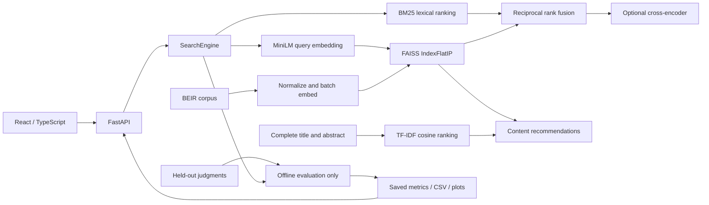

# Architecture

The API loads the index and BM25 once on startup. Neural models are initialized lazily,
reused, and serialized with a lock to keep CPU memory and inference concurrency bounded.
The index can serve recommendations without loading either model because paper vectors
are persisted. Each index records corpus fingerprint, IDs, dimensions, representation,
resolved checkpoint revisions, indexing durations and artifact checksums.

Related recommendations now have a separate training-selected weighted-RRF profile.
The lexical TF-IDF matrix is fitted lazily on complete corpus abstracts and reused under
the engine lock. The original cosine-only method remains selectable; incompatible indices
fall back to it automatically. Local and external recommendation tests are served through
`/api/recommendation-benchmark` with their distinct label/candidate definitions.

No database or LLM API is needed. Application retrieval never reads qrels. Offline evaluation
imports the same engine, supplies queries, and scores returned IDs separately. The UI's
benchmark page reads saved results and cannot trigger an expensive experiment.

Exact FAISS rankings are sorted by score then ID for deterministic ties. This small-corpus
implementation requests all distances to make cutoff ties deterministic; it is not designed
for million-document scale. Reranking reorders a candidate head and preserves the tail for
common-depth evaluation. API search reranks at least the requested result count (20–50).
The separate Optimized mode uses its frozen profile's fixed rerank depth, so increasing
the requested result count preserves the previously ranked prefix. It blends fusion
and cross-encoder ranks and retains the remaining candidates. Its profile is rejected
for mismatched corpora or model revisions; qrels are never read during serving.

Metadata filters search a full candidate list and exclude documents missing requested
metadata. SciFact therefore yields no matches for year or field filters. The UI does not
offer these unavailable filters; the API supports them for an ingested corpus.

Local demo trust boundary: no authentication, shared public corpus, loopback bindings.
Before internet hosting, add authentication if needed, request body/rate limits at the proxy,
TLS, worker capacity planning, monitoring, and license review. Do not use `--reload` in production.
