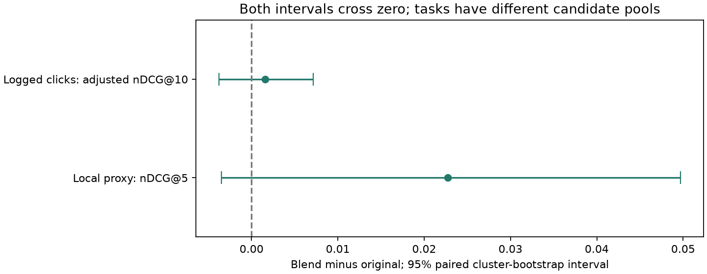

# Related-paper recommendation evaluation

The new semantic/lexical blend has higher point estimates in both tests below, but both
95% cluster-bootstrap intervals include zero. A reliable accuracy improvement is not yet established.
The original semantic method remains selectable in the paper dialog. These tests do not measure
personalization or provide a calibrated probability that a recommendation is relevant.

## Method and frozen selection

The baseline is the original stored MiniLM title-plus-abstract cosine-neighbor ranking.
The candidate adds TF-IDF cosine similarity over titles and complete abstracts: word unigrams
and bigrams, English stop words, sublinear term frequency, L2 normalization, float32, and
a 100,000-feature cap. Weighted RRF combines the two top-100 rankings with constant 5,
semantic weight 1, and lexical weight 0.5. The selected paper is always excluded.
No neural weights or search-ranking settings changed; no neural inference is needed at recommendation time.
TF-IDF is fitted lazily once per server process over unlabeled corpus text.

Thirteen candidates (the baseline plus twelve fusion settings) were compared on 94 training anchors.
Positive links join papers annotated as evidence for the same SciFact claim. Test graph membership
was used only to exclude all test papers from development, including as positive targets.
The profile was frozen before either test ranking was scored. No test-driven retuning was performed.
See `experiments/configs/related-study.json` and `experiments/results/related-development/selection.json`.

## Local full-corpus proxy test

58 held-out anchor papers, 116 directed positive links,
22 positive-graph components, and 5183 corpus papers.
These are co-evidence proxy labels, not direct human recommendation ratings. Unknown links are treated
as nonrelevant for scoring, although many may be genuinely relevant. Most corpus papers have no
usable co-evidence labels; this test does not establish accuracy across all 5,183 possible seed papers.

| Metric | Original semantic | Recommended blend |
|---|---:|---:|
| NDCG@5 | 0.5734 | 0.5961 |
| Recall@5 | 0.6753 | 0.6868 |
| Hit@5 | 0.7931 | 0.7931 |
| Precision@5 | 0.2724 | 0.2759 |
| Recall@100 | 0.9914 | 0.9914 |
| MAP@100 | 0.5360 | 0.5698 |
| MRR@100 | 0.6192 | 0.6564 |

nDCG@5 difference: +0.0228; 95% interval [-0.0035, +0.0497].
Per-anchor nDCG outcomes: {'improved': 15, 'worse': 5, 'unchanged': 38}.
Hit@5 is the fraction of seed papers with at least one known positive among five suggestions;
it is not the percentage of suggestions judged correct. Recall@5 uses all known positives as denominator.

## External logged-click test

All 1000 official test events from 862 seed papers;
8758 unique seed/candidate texts were embedded using the same pinned MiniLM revision.
Each event reranks ten previously displayed candidates. This is conditional reranking, not
retrieval from an unrestricted corpus. All unlabeled text in the candidate union was used for
TF-IDF fitting; click labels were used only for evaluation. The SciFact-selected weights were unchanged.

| Metric | Original semantic | Recommended blend |
|---|---:|---:|
| NDCG@10 | 0.5683 | 0.5731 |
| Adj-NDCG@10 | 0.5383 | 0.5399 |
| P@1 | 0.2370 | 0.2440 |
| Adj-P@1 | 0.1948 | 0.1995 |
| MRR | 0.4366 | 0.4426 |
| Adj-MRR | 0.3984 | 0.4004 |
| Pairwise accuracy | 0.6517 | 0.6612 |
| Adj-Pairwise accuracy | 0.6172 | 0.6204 |

Adjusted nDCG@10 difference: +0.0016; 95% interval [-0.0038, +0.0071].
Adjusted metrics weight each event by inverse propensity of the clicked paper's original display position.
Weight normalization cancels in the weighted mean. Score ties receive midpoint rank, matching the
official evaluator. Pairwise accuracy counts the fraction of displayed alternatives ranked below the
clicked paper, with half credit for ties; it is not overall recommendation relevance accuracy.
Clicks reflect exposure and historical recommender bias. Unclicked papers are not verified irrelevant.

Sources: [official SciDocs dataset and task description](https://github.com/allenai/scidocs),
[official click-evaluation formula](https://github.com/allenai/scidocs/blob/master/scidocs/recomm_click_eval.py).
This experiment evaluates raw content rankers using those formulas. It does not train the official
SciDocs feature-based recommender, so these numbers are not a reproduction of its full leaderboard protocol.

## Uncertainty and verification

Both comparisons use 10,000 paired cluster-bootstrap resamples, seed 42. Local resampling preserves
connected co-evidence components; external resampling preserves repeated events for each seed paper.
The local nDCG@5 comparison is primary; the external transfer test is secondary. Neither interval
excludes zero. Larger independent relevance judgments are needed before claiming a reliable gain.

Independent verification passed 812 local metric checks (pytrec_eval plus Hit@5),
8000 external per-event metric checks, all aggregate metrics, and
116 full serving-ranking parity checks. Top-five prefix consistency was checked too.
Frozen profile hashes match both tests. Source file hashes and model revisions are saved in the artifacts.



## Reproduce

```powershell
.venv\Scripts\python scripts/prepare_related_external.py
.venv\Scripts\python scripts/tune_related.py
.venv\Scripts\python scripts/benchmark_related.py
.venv\Scripts\python scripts/benchmark_related.py --external
.venv\Scripts\python scripts/verify_related.py
.venv\Scripts\python scripts/report_related.py
```

Run from the repository root after the SciFact index is built. External preparation downloads about
169 MB of public metadata/click files and encodes only the 8,758 needed texts, with resumable chunks.
No test metrics are computed during preparation. The raw data and embedding cache are git-ignored.
Keep source and profile hashes with any rerun; results may vary with dependencies or hardware.
