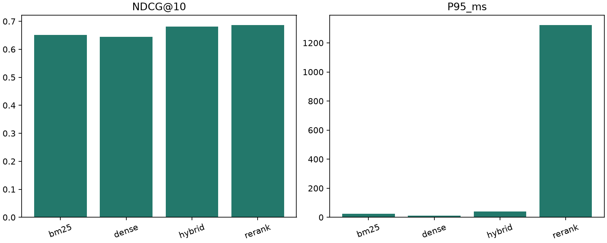

# Evaluating Hybrid Neural and Lexical Retrieval for Scientific Literature Discovery

## Abstract

ScholarMind AI evaluates lexical, dense, fused and cross-encoder retrieval on the BEIR
SciFact export: 5,183 abstracts and 300 held-out retrieval queries. All four configurations
execute locally on CPU. We measure effectiveness, stage latency and paired uncertainty.
The measured hybrid-minus-BM25 nDCG@10 change is +0.0298; the reranker-minus-hybrid
change is +0.0055. These are benchmark-specific observations, not general claims.

## Introduction

Researchers need to locate evidence across terminology and wording differences. Lexical
matching provides a strong, interpretable baseline, while embeddings offer a different
matching function. Fusion and pairwise neural scoring add complexity that must justify
itself through measured retrieval effectiveness and latency. This project implements the
complete corpus-to-browser path and makes the evaluation artifacts inspectable.

## Research questions

H1: Can dense retrieval find relevant papers missed by lexical matching? H2: Does combining
the rankings improve effectiveness? H3: Does cross-encoder reranking improve relevance at
additional computational cost? None is assumed true before measurement.

## Related work

BM25 models term-based evidence with document-length normalization [8]. Sentence-BERT provides
reusable sentence embeddings [1]. FAISS provides efficient vector indexing [2]. RRF merges
rank positions without assuming comparable raw scores [3]. Cross-encoders jointly process
queries and passages [4]. BEIR provides heterogeneous retrieval datasets and common evaluation
interfaces [5]; SciFact supplies scientific claims and evidence annotations [6]. This project
is a reproducible systems study of established methods, not a claim of a novel model.

## Methodology

NFKC/whitespace normalization retains original IDs. Both title and abstract are indexed.
No records were removed from this benchmark. BM25 uses Unicode word tokens with casefolding,
k1=1.5, b=0.75. MiniLM encodes batches of 32 into normalized 384-dimensional vectors.
Exact FAISS inner-product search is cosine-equivalent. RRF uses one-based ranks, constant
60 and 100 candidates per retriever. The cross-encoder reorders the top 20 hybrid candidates;
the remaining tail is retained to depth 100 for comparable evaluation. Ties sort by ID.
Application inference has no access to judgments. No fine-tuning was performed.

## Experimental setup

Executed timestamp (UTC): 2026-10-15T05:36:55.038636+00:00. CPU: Intel Core i5-13500H, 12 physical cores,
16 logical processors; approximately 16 GB RAM; four PyTorch inference threads. Runtime:
Windows-11-10.0.26300-SP0, Python 3.12.15. Checkpoint revisions,
dependency versions, corpus fingerprint and per-query timings are in `results.json`.
MiniLM revision: `1110a243fdf4706b3f48f1d95db1a4f5529b4d41`.
Cross-encoder revision: `233902d25c440f23af6f7d6e94d2946bac0bee0a`.

The test configuration was fixed before results were inspected. Development uses the first
50 lexicographically sorted IDs from the disjoint 809-query train split; it is a convenience
subset, not a representative random validation sample. No development winner is promoted
post hoc into the fixed test run. See [the protocol](EXPERIMENTS.md).

## Results

| Method | NDCG@10 | Recall@10 | Recall@100 | MAP@100 | MRR@100 | Precision@10 | P95_ms |
|---|---:|---:|---:|---:|---:|---:|---:|
| bm25 | 0.6519 | 0.7740 | 0.8731 | 0.6132 | 0.6233 | 0.0850 | 24.5821 |
| dense | 0.6451 | 0.7833 | 0.9250 | 0.6031 | 0.6110 | 0.0883 | 12.3839 |
| hybrid | 0.6816 | 0.8059 | 0.9577 | 0.6444 | 0.6539 | 0.0900 | 39.7497 |
| rerank | 0.6871 | 0.8129 | 0.9577 | 0.6485 | 0.6640 | 0.0907 | 1323.6752 |

MAP@100 and MRR@100 are depth-limited; unjudged documents count as nonrelevant. The custom
metric implementation was checked against pytrec_eval on graded test cases. Saved outputs
include per-query metrics and explicit ranked document IDs. Latency is warmed engine time,
not HTTP latency or a throughput test. This development-machine pass included incidental
editor/test activity; CPU timing remains sensitive to background load and is not a controlled microbenchmark.

## Statistical analysis and hypotheses

H1 is supported in the limited top-10 complementarity sense: on 33 queries, dense retrieval finds at least one judged relevant document missing from BM25's top 10. The reverse occurs on 26 queries. This does not establish that every such case is caused by semantic understanding, nor that dense retrieval wins overall.

H2 is supported on this benchmark: hybrid changes mean nDCG@10 relative to BM25 by +0.0298. See paired intervals and the dense comparison below.

H3: reranking changes mean nDCG@10 relative to hybrid by +0.0055, with P95 latency changing from 39.7 to 1323.7 ms. The relevance improvement is inconclusive; a higher point estimate alone is insufficient. These conclusions are specific to this corpus and setup.

- dense minus bm25: mean nDCG@10 difference -0.0068; 95% paired bootstrap interval [-0.0454, +0.0316], n=300.
- hybrid minus bm25: mean nDCG@10 difference +0.0298; 95% paired bootstrap interval [+0.0066, +0.0526], n=300.
- rerank minus hybrid: mean nDCG@10 difference +0.0055; 95% paired bootstrap interval [-0.0195, +0.0308], n=300.
- hybrid minus dense: mean nDCG@10 difference +0.0366; 95% paired bootstrap interval [+0.0084, +0.0645], n=300.

Intervals use 10,000 paired bootstrap resamples, seed 42, and no multiple-comparison correction.
Related claims can violate query independence. Statistical and practical significance are distinct.

## Ablation studies

Experiment A is the four-method comparison above. C changes rerank candidate depth;
E changes the fusion constant, both only on development queries. F records index build and
stage timings. Title/abstract representation and MPNet comparisons are supported by CLI
configuration but are not claimed as executed here.

| Development experiment | Queries | nDCG@10 | P95 ms |
|---|---:|---:|---:|
| ablation-depth-10 | 50 | 0.7308 | 700.5 |
| ablation-depth-20 | 50 | 0.7558 | 1434.7 |
| ablation-depth-50 | 50 | 0.7598 | 3688.6 |
| ablation-rrf-10 | 50 | 0.7276 | 45.5 |
| ablation-rrf-100 | 50 | 0.7078 | 44.6 |
| ablation-rrf-60 | 50 | 0.7076 | 42.6 |

Candidate depth affects both computation and which documents can enter the reordered head.
RRF sensitivity is specific to the candidate lists and development sample. Preserve the test
configuration rather than repeatedly evaluating whichever development choice looks best.
In this executed development study, depth 20 provides most of the observed depth-50
effectiveness at substantially lower latency. The smaller RRF constant performs better on
this subset than the predeclared default. These exploratory observations do not change the
fixed test configuration or establish a generally optimal setting.

## Error analysis

### Dense top-10 success absent from BM25 top 10

Query `1`: 0-dimensional biomaterials show inductive properties.

Judged relevant paper `31715818`: New opportunities: the use of nanotechnologies to manipulate and track stem cells.

BM25 rank: >100; dense rank: 5. This is a rank-based error case, not an inferred causal explanation.
### Dense top-10 success absent from BM25 top 10

Query `1029`: Reduced responsiveness to interleukin-2 in regulatory T cells is associated with greater resistance to autoimmune diseases such as Type 1 Diabetes.

Judged relevant paper `13940200`: Large-scale genetic fine mapping and genotype-phenotype associations implicate polymorphism in the IL2RA region in type 1 diabetes

BM25 rank: 28; dense rank: 2. This is a rank-based error case, not an inferred causal explanation.
### BM25 top-10 success absent from dense top 10

Query `1024`: Recurrent mutations occur frequently within CTCF anchor sites adjacent to oncogenes.

Judged relevant paper `5373138`: 3D Chromosome Regulatory Landscape of Human Pluripotent Cells.

BM25 rank: 1; dense rank: 41. This is a rank-based error case, not an inferred causal explanation.
### BM25 top-10 success absent from dense top 10

Query `1041`: Replacement of histone H2A with H2A.Z slows gene activation in yeasts by stabilizing +1 nucleosomes.

Judged relevant paper `16626264`: Genome-Wide Dynamics of Htz1, a Histone H2A Variant that Poises Repressed/Basal Promoters for Activation through Histone Loss

BM25 rank: 10; dense rank: 11. This is a rank-based error case, not an inferred causal explanation.

## Limitations

SciFact is small, mainly biomedical, English, and sparsely judged. Its claim-based queries
do not represent all academic discovery needs. Indexing uses abstracts rather than full text.
MiniLM truncates 3,681/5,183 combined documents at 256 tokens; the cross-encoder limits pairs
to 512 tokens. No claim of complete-document comprehension is warranted. Pretrained scientific
text overlap is possible and not audited. Metadata is incomplete and deliberately not invented.
NFCorpus, MPNet, fine-tuning, approximate indexing, GPU execution and demographic fairness
are not evaluated. Single-pass CPU timing is not a production SLA. Semantic Scholar live
ingestion returned HTTP 429; its parsing/cache behavior is fixture-tested. Docker and hosted
CI execution require infrastructure not verified by local tests.

## Conclusion

The saved measurements establish a working, reproducible comparison on a specific corpus.
Hybrid and neural reranking must be judged against the lexical baseline using the measured
differences, uncertainty and added latency above. Stronger general claims require additional
datasets, repetition, controlled hardware and independent relevance assessment.

## References

1. Reimers and Gurevych (2019), [Sentence-BERT](https://arxiv.org/abs/1908.10084).
2. Johnson, Douze and Jégou (2017), [Billion-scale similarity search with GPUs](https://arxiv.org/abs/1702.08734).
3. Cormack, Clarke and Buettcher (2009), [Reciprocal Rank Fusion](https://cormack.uwaterloo.ca/cormacksigir09-rrf.pdf).
4. [MS MARCO MiniLM cross-encoder model card](https://huggingface.co/cross-encoder/ms-marco-MiniLM-L6-v2).
5. [BEIR official repository and publication links](https://github.com/beir-cellar/beir).
6. Wadden et al. (2020), [SciFact: Fact or Fiction](https://github.com/allenai/scifact).
7. [MiniLM sentence embedding model card](https://huggingface.co/sentence-transformers/all-MiniLM-L6-v2).
8. Robertson and Zaragoza (2009), [The Probabilistic Relevance Framework: BM25 and Beyond](https://doi.org/10.1561/1500000019).
